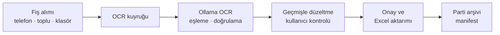
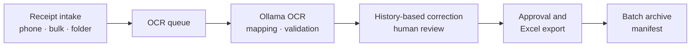

<a id="readme"></a>

<div align="center">

# Mazot Fiş Takip Sistemi

### Fuel Receipt Tracking System

Yerel OCR · Kullanıcı kontrollü doğrulama · Excel aktarımı  
Local OCR · Human review · Excel export

[**Türkçe**](#turkce) · [**English**](#english)

[](https://github.com/MehmetEmreee/mazot-fis-takip-sistemi/blob/main/LICENSE)
[](#tr-requirements)
[](#tr-architecture)

</div>

---

<a id="turkce"></a>

## Türkçe

[English version ↓](#english)

**Yerel yapay zekâ ile fiş okuma, kullanıcı kontrollü doğrulama ve Excel aktarımı.**

Akaryakıt fişi fotoğraflarını yapılandırılmış kayıtlara dönüştüren, tarayıcı üzerinden kullanılan yerel bir uygulama. Fişler Ollama üzerinde çalışan görsel dil modeliyle okunur; kullanıcı sonuçları görselle karşılaştırır, düzeltir ve onayladığı kayıtları mevcut Excel defterine aktarır.

> OCR çıktısı bir öneridir. Muhasebe veya operasyon kayıtlarına aktarılmadan önce fişin aslıyla karşılaştırılmalıdır. Bu proje, mevcut haliyle kurumsal üretim sertifikasyonu veya hatasız çalışma garantisi sunmaz.

## İçindekiler

- [Yetenekler](#tr-features)
- [Çalışma akışı](#tr-workflow)
- [Gereksinimler](#tr-requirements)
- [Kurulum ve başlatma](#tr-installation)
- [Kullanım](#tr-usage)
- [Excel sözleşmesi](#tr-excel)
- [Veri, yedekleme ve güvenlik](#tr-data-security)
- [Mimari](#tr-architecture)
- [Yapılandırma](#tr-configuration)
- [Test ve ölçüm](#tr-testing)
- [Bilinen sınırlamalar](#tr-limitations)
- [Sorun giderme](#tr-troubleshooting)
- [Katkı ve lisans](#tr-contributing)

<a id="tr-features"></a>

## Yetenekler

| Alan | Kapsam |
| --- | --- |
| Görsel alımı | Bilgisayardan toplu seçim, telefon tarayıcısı ve izlenen gelen kutusu klasörü |
| Görsel biçimleri | JPEG, PNG, WEBP, BMP; `pillow-heif` ile HEIC/HEIF dönüşümü |
| Yerel OCR | Ollama üzerinden varsayılan `qwen2.5vl:7b` modeli |
| Yapılandırılmış alanlar | Fiş numarası, tarih, firma, plaka/ekipman, ad soyad, kilometre ve litre |
| Kontrol ekranı | Görsel ve alanları birlikte inceleme, yakınlaştırma, döndürme ve elle düzeltme |
| Geçmişten öğrenme | Excel referansları ve kullanıcı düzeltmelerinden öneriler; belirli eşiklerde otomatik düzeltme |
| Parti yönetimi | Aktif kayıtları gruplama, arşivleme ve eski partileri inceleme |
| Excel aktarımı | Kullanıcının seçtiği dosya, sayfa ve başlangıç satırına manuel aktarım |
| Veri koruma | Görsel hash kontrolü, mantıksal silme, günlük JSON/Excel yedekleri ve arşiv manifestleri |

**Dil kapsamı:** README Türkçe ve İngilizce sunulur. Uygulama arayüzü ve iş kuralları Türkçe odaklıdır; uygulama içinde dil değiştirme özelliği bulunmaz.

<a id="tr-workflow"></a>

## Çalışma akışı



Model ilk kurulumda indirilir. Bağımlılıklar ve model hazır olduğunda normal OCR akışı yerelde çalışır; uygulamanın fiş okuma akışı bir bulut OCR hizmeti kullanmaz.

<a id="tr-requirements"></a>

## Gereksinimler

- Windows veya macOS: depoda bu sistemlere yönelik kurulum ve başlatma betikleri bulunur.
- Kaynaktan çalıştırmak için **Python 3.10+**. Python 3.12, macOS kurulum yardımcısının ilk tercihidir.
- [Ollama](https://ollama.com/download) ve `qwen2.5vl:7b` modeli.
- Güncel bir web tarayıcısı.
- Model, görseller, Excel dosyaları ve yedekler için yeterli disk alanı.
- İlk kurulum ve model indirme sırasında internet bağlantısı.

GPU hızlandırması OCR süresini iyileştirebilir. Doğrulanmış minimum RAM/VRAM sınırı veya donanımlar arası performans garantisi yayımlanmamıştır. Hedef bilgisayarda ölçüm yapın. Linux için özel başlatma betiği ve doğrulanmış platform testi bulunmaz.

<a id="tr-installation"></a>

## Kurulum ve başlatma

### 1. Depoyu alın

```bash
git clone https://github.com/MehmetEmreee/mazot-fis-takip-sistemi.git
cd mazot-fis-takip-sistemi
```

### 2. İşletim sisteminize göre kurun

| Sistem | İlk kurulum | Sonraki açılışlar |
| --- | --- | --- |
| Windows | Ollama'yı kurun, ardından `scripts\windows\KURULUM.bat` çalıştırın. | `scripts\windows\BASLAT_ARAYUZ.bat` |
| macOS | Ollama'yı kurun, ardından `scripts/macos/KURULUM.command` çalıştırın. | `scripts/macos/BASLAT.command` |

Kurulum betikleri varsayılan modeli indirir ve Python ortamını hazırlar. macOS'ta dosyalar çift tıklamayla çalışmıyorsa terminalden `bash scripts/macos/KURULUM.command` ve `bash scripts/macos/BASLAT.command` kullanılabilir. Başlatıcılar nereden açılırsa açılsın depo kökünde çalışır.

### 3. Kaynaktan manuel kurulum

Önce Ollama hizmetini açın ve modeli indirin:

```bash
ollama pull qwen2.5vl:7b
```

**Windows — PowerShell:**

```powershell
py -3.12 -m venv .venv
.\.venv\Scripts\python.exe -m pip install -r requirements.txt
.\.venv\Scripts\python.exe -m mazot
```

**macOS:**

```bash
python3 -m venv .venv
.venv/bin/python -m pip install -r requirements.txt
.venv/bin/python -m mazot
```

Tarayıcı `http://127.0.0.1:8765` adresinde açılır. Başlatıcı terminalinin kapanması uygulamayı durdurur.

> Varsayılan başlatıcı sunucuyu `0.0.0.0:8765` üzerinde açar; aynı ağa erişimi olan istemciler uygulamaya ulaşabilir. Yalnız bilgisayarda kullanım için aşağıdaki yerel başlatma seçeneğini kullanın.

### Yalnız bu bilgisayardan erişim

Ollama hizmetini ayrıca açtıktan sonra:

```bash
# macOS; Windows'ta Python yolu: .\.venv\Scripts\python.exe
.venv/bin/python -m mazot.arayuz --host 127.0.0.1 --port 8765
```

Bu komut başlatıcının günlük yedekleme, eski veriyi `data/` klasörüne taşıma ve Ollama hazırlama adımlarını çalıştırmaz. Yedeklerinizi ayrıca yönetin.

### Windows EXE

Başlatma betiği `.venv\Scripts\python.exe` varsa kaynak kodu, yoksa depo kökündeki `Mazot Fis Kontrol.exe` dosyasını kullanır. EXE depoda tutulmaz; Windows'ta `scripts\windows\EXE_OLUSTUR.bat` ile `packaging/mazot_fis_kontrol.spec` üzerinden PyInstaller ile oluşturulur ve depo köküne kopyalanır. Hazır EXE'yi dağıtmak için GitHub Releases kullanın.

<a id="tr-usage"></a>

## Kullanım

1. **Fişleri ekleyin:** Toplu Ekle ekranını, telefon sayfasını veya `gelen_fisler/` klasörünü kullanın.
2. **OCR'ın tamamlanmasını bekleyin:** İşleme sürerken fişi silmeyin, düzeltmeyin veya onaylamayın.
3. **Asıl görselle karşılaştırın:** Özellikle fiş numarası, tarih, plaka, kilometre ve litreyi kontrol edin. Geçmiş önerileri doğruluk garantisi değildir.
4. **Düzeltin ve onaylayın:** `Doğru, onayla` düğmesini kullanın. Hızlı onay ve sonraki kayıt için `Ctrl + Enter` kullanılabilir.
5. **Excel'e aktarın:** Dosya, sayfa ve başlangıç satırını seçin. Hedef Excel'i kapatın ve hedef hücrelerin boş olduğunu doğrulayın.
6. **Yeni parti açın:** OCR işlemleri ve onaylar tamamlandıktan sonra `+ Yeni` ile mevcut partiyi arşivleyin.

### Telefon ve gelen kutusu

Telefon ve bilgisayar aynı güvenilir yerel ağdayken terminalde gösterilen `http://<bilgisayar-ip>:8765/cek?anahtar=…` bağlantısını açın (arayüzdeki **Fiş Çek** düğmesi de bu bağlantıyı taşır). Anahtar telefona yalnız fotoğraf yükleme ve kendi yüklediklerinin sonucunu görme yetkisi verir; `python -m mazot.erisim anahtar-yenile` eski bağlantıyı geçersiz kılar. Gerekirse işletim sistemi güvenlik duvarında yalnız güvenilir yerel ağ erişimini sağlayın.

Çok sayıda görsel için LocalSend, USB veya bir klasör senkronizasyon aracıyla dosyaları `gelen_fisler/` içine bırakabilirsiniz. İzleyici yaklaşık üç saniyede bir tarar; dosyayı iki ardışık taramada değişmeden gördüğünde ve bütünlük kontrolü geçtiğinde kabul eder.

| Gelen kutusu alt klasörü | Anlamı |
| --- | --- |
| `_islendi/<tarih>/` | Kuyruğa kabul edilmiş kaynak görseller; OCR başarısı anlamına gelmez. |
| `_tekrar/` | Mevcut hash indeksine göre daha önce kabul edilmiş görseller |
| `_hatali/` | Desteklenmeyen, bozuk veya bekleme süresini aşan eksik dosyalar |

<a id="tr-excel"></a>

## Excel sözleşmesi

Uygulama genel amaçlı bir Excel şema eşleyicisi değildir. Aktarım sütunları mevcut iş akışına göre sabittir:

| Sütun | Alan |
| --- | --- |
| A | Tarih |
| B | Fiş / fatura numarası |
| C | Firma |
| D | Araç plakası / ekipman |
| E | Ad soyad |
| F | Kilometre |
| H | Alınan litre |

G ve I–M sütunlarına aktarım yapılmaz. Varsayılan başlangıç, son işlem satırından iki satır sonradır; arada bir boş satır bırakılır. Hücre biçimleri son işlem satırından kopyalanır. Normal aktarım yalnız onaylı, silinmemiş, OCR hatası taşımayan ve daha önce aktarılmamış kayıtları seçer. `Tümü` seçeneği daha önce aktarılmış kayıtları da kapsar; aynı hedefte mükerrer satırlar oluşturabilir.

`.xlsx` ve `.xlsm` dosyaları seçilebilir. Makro içeren defterlerde makroların korunması güvence altına alınmış değildir; doğrulama yapılmadan asıl `.xlsm` dosyasına aktarım yapmayın.

<a id="tr-data-security"></a>

## Veri, yedekleme ve güvenlik

Bütün değişen veriler depo kökündeki `data/` klasöründedir (`MAZOT_VERI_DIZINI` ile değiştirilebilir). Eski sürümlerde bu dosyalar doğrudan kökteydi; uygulama ilk açılışta onları bir kez `data/` altına taşır ve `data/tasima_kaydi.json` dosyasına yazar. Bir öğe taşınamazsa (ör. dosya açık) hiçbir şey taşınmaz ve uygulama nedenini söyleyerek kapanır.

| Konum (`data/` altında) | İçerik |
| --- | --- |
| `sonuclar.json` | Aktif fiş kayıtları ve işlem durumu |
| `fisler/` | Geçici, firma bazında düzenlenmiş ve silinen görseller |
| `gelen_fisler/` | İzlenen giriş klasörü ve kaynak görseller (eski kökteki `gelen_fisler/` de varsa taranır) |
| `excel_referans.json` | Excel'den öğrenilen referanslar |
| `kullanici_ogrenmeleri.json` | Kullanıcı düzeltmeleri ve eşleştirmeler |
| `aktif_parti.json` | Aktif parti bilgisi |
| `arsiv/` | Kapanan partiler, görseller ve bütünlük manifestleri |
| `output/` | Yüklenen Excel dosyaları ve son aktarım ayarları |
| `yedekler/` | Otomatik JSON ve Excel yedekleri; `yedekler/tam/` artımlı tam yedek |
| `denetim/<yıl-ay>.jsonl` | Kim, ne zaman, neyi yükledi/düzenledi/onayladı/sildi/aktardı |
| `kullanicilar.json` | Kullanıcılar (PBKDF2 parola özetleri), roller, telefon anahtarı |

**Yedek ve geri yükleme.** Program her açılışta günde bir kez görseller dahil tam anlık yedek alır (`yedekler/tam/`). Yedek içerik adreslidir: her dosya SHA-256'sıyla bir kez saklanır, değişmeyen dosyalar yeniden okunmaz; yedek klasörü yaklaşık veri kadar yer kaplar ve son 14 anlık yedek tutulur. Excel aktarımı hedef dosya için günde bir kez yazma öncesi kopya oluşturur (90 gün). Geri yükleme (program kapalıyken):

```bash
python -m mazot.yedekleme listele
python -m mazot.yedekleme dogrula <kimlik>
python -m mazot.yedekleme geri-yukle <kimlik>
```

Geri yükleme önce yedeği baştan sona doğrular; mevcut veri silinmez, `yedekler/geri_yukleme_oncesi_<zaman>/` altına taşınır; bir adım başarısız olursa mevcut veri yerine konur. Yedekler aynı diskte durur: disk arızasına karşı `yedekler/tam/` klasörünü ayrıca harici bir depolamaya kopyalayın. Proje dışındaki hedef Excel defterleri bu yedeğe girmez.

**Erişim.** Hiç kullanıcı tanımlı değilse (tek kullanıcı modu) yalnız programın çalıştığı bilgisayar arayüzü kullanabilir; ağdan yalnız telefon anahtarlı bağlantıyla fotoğraf yüklenebilir. Birden çok kişi veya başka bilgisayarlar kullanacaksa kullanıcı tanımlayın; o andan itibaren herkes (bu bilgisayar dahil) adı ve parolasıyla girer ve her işlem kişiye bağlanır:

```bash
python -m mazot.erisim ekle ayse yonetici     # tüm yetkiler + tüm denetim geçmişi
python -m mazot.erisim ekle veli kontrol      # görüntüle, düzelt, onayla, sil, Excel'e aktar
python -m mazot.erisim ekle sofor yukleme     # yalnız fotoğraf yükleme
```

Aynı adresten 5 hatalı girişten sonra bir dakika beklenir. Fiş kaydında yükleyen, son düzenleyen, onaylayan, silen ve Excel'e aktaran tutulur; ayrıntılı geçmiş (alan bazında eski → yeni) `denetim/` altındadır ve arayüzde fişin altında özetlenir. Bağlantı HTTP'dir (yerel ağ içinde şifresiz): internete açmayın, port yönlendirme yapmayın; erişimi güvenilir ağlarla sınırlayın. Uygulama Türkçe fiş şablonuna ve belirli iş kurallarına göre tasarlanmıştır.

<a id="tr-architecture"></a>

## Mimari

```text
mazot/                 Uygulama paketi (python -m mazot)
  ui/                  HTML, CSS ve JavaScript kontrol arayüzü
tests/                 Birim testleri (Ollama gerektirmez)
tools/                 Ölçüm ve bakım araçları (python -m tools.<ad>)
experiments/           Kullanılmayan yaklaşımların deney betikleri
scripts/windows/       KURULUM, BASLAT_ARAYUZ, EXE_OLUSTUR, YENIDEN_BASLAT
scripts/macos/         KURULUM, BASLAT, YENIDEN_BASLAT (.command)
packaging/             PyInstaller tanımı (Windows EXE)
docs/                  Kullanım kılavuzu ve geliştirme notları
data/                  Çalışma verisi (git dışında, ilk açılışta oluşur)
```

| Modül (`mazot/`) | Sorumluluk |
| --- | --- |
| `uygulama.py` | Başlatma, günlük veri yedeği ve Ollama kontrolü |
| `yollar.py` | Kod, arayüz ve veri yolları; eski kök verisini `data/` altına taşıma |
| `arayuz.py` | HTTP API, yüklemeler, klasör izleme, kayıt yönetimi ve OCR işçisi |
| `extract_json.py` | Görsel hazırlama, Ollama çağrısı ve ham alan eşleme |
| `normalizasyon.py` / `dogrulama.py` | Alan normalizasyonu ve merkezi iş kuralları |
| `excel_ogrenme.py` / `otomatik_duzeltme.py` | Referanslar, benzerlik önerileri ve geçmişe dayalı otomatik düzeltme |
| `alan_yeniden_okuma.py` | Geçmişte karşılığı olmayan alanı fişten kırpıp alan adıyla yeniden okuma |
| `excel_aktar.py` | Excel önizleme, yedekleme ve aktarım |
| `parti_yonetimi.py` | Parti arşivleme ve SHA-256 manifestleri |

Çalışma zamanı: Python standart HTTP sunucusu, Pillow, Requests, RapidFuzz, openpyxl, pillow-heif, NumPy ve OpenCV (şüpheli alanların yeniden okunmasında tablo kutularını bulmak için). Kalıcılık JSON ve dosya sistemi üzerinden sağlanır; ayrı veritabanı yoktur. OCR işleri tek arka plan işçisiyle sırayla çalışır.

<a id="tr-configuration"></a>

## Yapılandırma

| Ayar | Varsayılan | Açıklama |
| --- | --- | --- |
| `QWEN_MODEL` | `qwen2.5vl:7b` | Süreç başlatılırken seçilen Ollama modeli |
| `QWEN_NUM_CTX` | `4096` | Model bağlam boyutu |
| `MAZOT_YENIDEN_OKUMA` | `1` | `0` ise, otomatik düzeltmeden sonra geçmişte karşılığı olmayan alanların kırpılıp yeniden okunması kapanır |
| OCR uzun kenarı | `1600` px | Kaynak koddaki varsayılan görsel küçültme sınırı |
| Ollama OCR adresi | `http://localhost:11434/api/chat` | Kaynak kodda tanımlı; ortam değişkeni değildir. |
| Yükleme sınırı | `30 MiB` | Tek yükleme için sunucu sınırı |

Doğrudan sunucu seçenekleri:

```text
python -m mazot.arayuz --host ADRES --port PORT --data-file JSON_YOLU
                       --fisler-dir GORSEL_DIZINI --gelen-dir GELEN_DIZINI --no-browser
```

Bu seçenekler bütün uygulama verilerini tek başına izole etmez; öğrenme ve bazı çıktı yolları proje köküne bağlı kalır. Tam izolasyon gereken deneylerde ayrı bir proje kopyası kullanın. Alternatif model önce Ollama'ya kurulmalıdır; kurulum betikleri `QWEN_MODEL` değerinden bağımsız olarak varsayılan modeli indirir.

<a id="tr-testing"></a>

## Test ve ölçüm

Temel testleri kurulu sanal ortamın Python'u ile çalıştırın:

```bash
python -m unittest discover -s tests -t . -v
```

Aynı testler her gönderimde GitHub Actions ile Windows, macOS ve Linux'ta çalışır (`.github/workflows/testler.yml`). Normalizasyon, doğrulama, öğrenme, temel arşivleme ve toplu yükleme kontrolleri Ollama olmadan çalışabilir. Bazı Excel testleri kişisel örnek dosya yoksa atlanır. `experiments/` altındaki `test_qwen_vl.py` ve `test_trocr.py`, temel otomatik paketten ayrı OCR deney araçlarıdır; TrOCR ek bağımlılıklar ve model indirmesi gerektirir.

Etiketlenmiş fiş kopyalarıyla OCR karşılaştırması:

```bash
python -m tools.ocr_benchmark --model qwen2.5vl:7b --max-kenar 1600 \
  --ornek 20 --data-file /path/to/sonuclar.json \
  --images-dir /path/to/fisler --output /path/to/benchmark_sonucu.json
```

Diğer ölçüm ve bakım araçları `tools/README.md` içinde listelenir. Windows'ta komutu tek satırda ve uygun dosya yollarıyla kullanın. Araç onaylı ve ham OCR alanları bulunan kayıtları örnekler; üretimdeki otomatik öğrenme düzeltmesini bütünüyle ölçmez. Sabit test setinde `--esik-tam` / `--esik-alan` verilirse doğruluk eşiğin altına düşünce çıkış kodu 1 olur. Excel aktarımının doğruluğu `python -m tools.excel_dogruluk`, uzun süreli çalışma (kuyruk, bellek, disk) `python -m tools.uzun_sure_testi` ile ölçülür. `tests/test_kesinti.py` parti kapatma, yükleme, OCR ve Excel aktarımı sırasında süreci her dosya adımında öldürüp açılış kurtarmasının veriyi kayıpsız toparladığını doğrular. Model, donanım, görsel kümesi ve soğuk/sıcak çalışma koşullarını sonuçlarla birlikte kaydedin. Eksik görseller nedeniyle ölçülen örnek sayısı istenenden az olabilir. Sonuç dosyaları kişisel veri içerebilir.

<a id="tr-limitations"></a>

## Bilinen sınırlamalar

Aşağıdaki durumlar kaynak incelemesinde belirlenmiştir; uygulamayı kritik kayıtların tek doğruluk kaynağı olarak kullanmadan önce değerlendirin:

- Başlangıç satırı seçimi dolu hücreleri ezebilir; hedef aralığı önceden doğrulayın.
- Excel aktarımı defteri her seferinde baştan okuyup yazar; süre defter büyüklüğüyle orantılıdır (birkaç bin satırda birkaç saniye).
- Yarım kalan bir Excel aktarımı, tekrar denendiğinde defterdeki gizli `_mazot_aktarim` sayfasındaki kimliklerle tamamlanır; bu sayfayı silmeyin. Yarım aktarımın satırı sonradan elle değiştirilmişse uygulama tahmin yürütmez, durur ve satırı kontrol etmenizi ister.
- Kesinti dayanıklılığı süreç kesintisi içindir; elektrik kesintisinde işletim sisteminin disk önbelleği ayrıca risk taşır (UPS önerilir).
- Bağımlılıklar tam sürümlerle kilitlenmemiştir. Kurulumlar arası davranış için aynı sürümleri ayrıca kaydedin.

<a id="tr-troubleshooting"></a>

## Sorun giderme

| Belirti | Kontrol |
| --- | --- |
| Ollama/model bulunamadı | Ollama'yı açın; `ollama list` ile modeli kontrol edin; gerekirse `ollama pull qwen2.5vl:7b` çalıştırın. |
| Telefon bağlanamıyor | Aynı ağ, terminaldeki bilgisayar IP'si, güvenlik duvarı ve sunucunun bağlanma adresini kontrol edin. `127.0.0.1` telefondan erişilemez. |
| HEIC açılamıyor | Sanal ortamda `pillow-heif` kurulumunu kontrol edin veya JPEG kullanın. |
| Excel yazılamıyor | Dosyayı Excel'de kapatın; izinleri, disk alanını ve yedek klasörünü kontrol edin. |
| Kuyruk ilerlemiyor | Terminal hatalarını ve Ollama durumunu inceleyin. Yeniden başlatmadan önce verilerin yedeğini alın. |
| Kaynak değişti, EXE değişmedi | `.venv` ile kaynaktan çalıştırın veya Windows EXE'sini yeniden oluşturun. |

<a id="tr-contributing"></a>

## Katkı ve lisans

Hata bildiriminde işletim sistemi, Python/Ollama sürümleri, model adı, commit, yeniden üretme adımları ve kişisel verilerden arındırılmış hata çıktısını paylaşın. Gerçek fiş veya muhasebe defteri yüklemeyin. Düzeltmeler için regresyon testi; performans değişiklikleri için aynı koşullarda önce/sonra ölçümü ekleyin.

[Hata bildirimi](https://github.com/MehmetEmreee/mazot-fis-takip-sistemi/issues) · [Kısa kullanım kılavuzu](https://github.com/MehmetEmreee/mazot-fis-takip-sistemi/blob/main/docs/KULLANIM.md)

[MIT Lisansı](https://github.com/MehmetEmreee/mazot-fis-takip-sistemi/blob/main/LICENSE) · © 2026 Mehmet Emre Çelebi. Üçüncü taraf yazılım ve model lisansları ayrıca geçerlidir.

[↑ Dil seçimi / Language selection](#readme)

---

<a id="english"></a>

## English

[Türkçe sürüm ↑](#turkce)

**Local AI receipt extraction, human review, and Excel export.**

A locally hosted, browser-based application that converts fuel receipt photographs into structured records. A vision-language model running through Ollama reads each receipt; users compare the results against the image, correct the fields, and export approved records to an existing Excel workbook.

> OCR output is a suggestion. Verify it against the original receipt before using it for accounting or operational records. The current project does not provide enterprise production certification or a guarantee of error-free operation.

## Contents

- [Capabilities](#en-features)
- [Workflow](#en-workflow)
- [Requirements](#en-requirements)
- [Installation and startup](#en-installation)
- [Usage](#en-usage)
- [Excel contract](#en-excel)
- [Data, backups, and security](#en-data-security)
- [Architecture](#en-architecture)
- [Configuration](#en-configuration)
- [Testing and measurement](#en-testing)
- [Known limitations](#en-limitations)
- [Troubleshooting](#en-troubleshooting)
- [Contributing and license](#en-contributing)

<a id="en-features"></a>

## Capabilities

| Area | Scope |
| --- | --- |
| Image intake | Desktop bulk selection, a phone browser, and a watched inbox directory |
| Image formats | JPEG, PNG, WEBP, BMP; HEIC/HEIF conversion through `pillow-heif` |
| Local OCR | Ollama with `qwen2.5vl:7b` as the default model |
| Structured fields | Receipt number, date, company, vehicle plate/equipment, person, mileage, and fuel volume |
| Review interface | Image and field comparison, zoom, rotation, and manual corrections |
| Learning from history | Suggestions from Excel references and user corrections; automatic corrections at defined thresholds |
| Batch management | Group active records, archive completed batches, and inspect past batches |
| Excel export | Manual export to a user-selected workbook, sheet, and starting row |
| Data safeguards | Image hash checks, soft deletion, daily JSON/Excel backups, and archive manifests |

**Language scope:** This README is available in Turkish and English. The application interface and business rules are Turkish-oriented; the application does not currently include a language switcher.

<a id="en-workflow"></a>

## Workflow



The model is downloaded during initial setup. Once dependencies and the model are available, the normal OCR workflow runs locally; the application's receipt extraction workflow does not use a cloud OCR service.

<a id="en-requirements"></a>

## Requirements

- Windows or macOS: the repository includes setup and startup scripts for these platforms.
- **Python 3.10+** for running from source. Python 3.12 is the first choice in the macOS environment helper.
- [Ollama](https://ollama.com/download) and the `qwen2.5vl:7b` model.
- A current web browser.
- Sufficient disk space for the model, images, Excel files, and backups.
- An internet connection for initial dependency installation and model downloads.

GPU acceleration may improve OCR latency. No validated minimum RAM/VRAM requirement or cross-hardware performance guarantee has been published. Benchmark on the target computer. Linux has no dedicated startup script or verified platform test.

<a id="en-installation"></a>

## Installation and startup

### 1. Get the repository

```bash
git clone https://github.com/MehmetEmreee/mazot-fis-takip-sistemi.git
cd mazot-fis-takip-sistemi
```

### 2. Use the platform setup scripts

| Platform | Initial setup | Subsequent launches |
| --- | --- | --- |
| Windows | Install Ollama, then run `scripts\windows\KURULUM.bat`. | `scripts\windows\BASLAT_ARAYUZ.bat` |
| macOS | Install Ollama, then run `scripts/macos/KURULUM.command`. | `scripts/macos/BASLAT.command` |

The setup scripts download the default model and prepare the Python environment. If double-clicking the macOS scripts does not work, run `bash scripts/macos/KURULUM.command` and `bash scripts/macos/BASLAT.command` from a terminal. The launchers always run from the repository root, wherever they are opened from.

### 3. Manual setup from source

Start the Ollama service and download the model:

```bash
ollama pull qwen2.5vl:7b
```

**Windows — PowerShell:**

```powershell
py -3.12 -m venv .venv
.\.venv\Scripts\python.exe -m pip install -r requirements.txt
.\.venv\Scripts\python.exe -m mazot
```

**macOS:**

```bash
python3 -m venv .venv
.venv/bin/python -m pip install -r requirements.txt
.venv/bin/python -m mazot
```

The browser opens at `http://127.0.0.1:8765`. Closing the launcher terminal stops the application.

> The default launcher binds the server to `0.0.0.0:8765`, making it reachable by clients with network access to the computer. For computer-only access, use the loopback startup option below.

### Computer-only access

Start Ollama separately, then run:

```bash
# macOS; on Windows, use .\.venv\Scripts\python.exe instead
.venv/bin/python -m mazot.arayuz --host 127.0.0.1 --port 8765
```

This command bypasses the launcher's daily backup, legacy data migration to `data/`, and Ollama preparation steps. Manage backups separately.

### Windows executable

The startup script runs source code when `.venv\Scripts\python.exe` exists; otherwise, it uses `Mazot Fis Kontrol.exe` in the repository root. The executable is not stored in the repository: on Windows, `scripts\windows\EXE_OLUSTUR.bat` builds it with PyInstaller from `packaging/mazot_fis_kontrol.spec` and copies it to the repository root. Use GitHub Releases to distribute a prebuilt executable.

<a id="en-usage"></a>

## Usage

1. **Add receipts:** Use `Toplu Ekle` (Bulk Add), the phone page, or the `gelen_fisler/` directory.
2. **Wait for OCR to finish:** Do not delete, edit, or approve a receipt while it is processing.
3. **Compare with the original image:** Pay particular attention to the receipt number, date, plate, mileage, and fuel volume. Historical suggestions are not a correctness guarantee.
4. **Correct and approve:** Select `Doğru, onayla` (Approve). `Ctrl + Enter` approves the current receipt and advances to the next one.
5. **Export to Excel:** Select the workbook, sheet, and starting row. Close the target workbook in Excel and verify that the destination cells are empty.
6. **Start a new batch:** After OCR and approvals are complete, use `+ Yeni` (New) to archive the current batch.

### Phone access and watched inbox

With the phone and computer on the same trusted local network, open the terminal-displayed link `http://<computer-ip>:8765/cek?anahtar=…` (the **Fiş Çek** button in the interface carries the same link). The key only grants uploading photos and seeing the results of one's own uploads; `python -m mazot.erisim anahtar-yenile` invalidates the old link. If necessary, allow access through the operating system firewall only for a trusted local network.

For larger collections, use LocalSend, USB, or a folder synchronization tool to place images in `gelen_fisler/`. The watcher scans approximately every three seconds and accepts a file after it remains unchanged across two consecutive scans and passes the completeness check.

| Inbox subdirectory | Meaning |
| --- | --- |
| `_islendi/<date>/` | Source images accepted into the queue; this does not indicate successful OCR. |
| `_tekrar/` | Images already accepted according to the current hash index |
| `_hatali/` | Unsupported, corrupt, or incomplete files that exceeded the waiting period |

<a id="en-excel"></a>

## Excel contract

The application is not a general-purpose Excel schema mapper. Export columns are fixed to the existing workflow:

| Column | Field |
| --- | --- |
| A | Date |
| B | Receipt / invoice number |
| C | Company |
| D | Vehicle plate / equipment |
| E | Person's name |
| F | Mileage |
| H | Fuel volume in litres |

The exporter does not write columns G or I–M. The default starting row is two rows after the last transaction row, leaving one blank row. Cell formatting is copied from the last transaction row. Normal export selects approved, non-deleted records without an OCR error that have not already been exported. The `Tümü` (All) option also includes previously exported records and can create duplicates in the same destination.

`.xlsx` and `.xlsm` files can be selected. Macro preservation is not assured; do not export to an original macro-enabled workbook without validating preservation on a copy first.

<a id="en-data-security"></a>

## Data, backups, and security

All mutable data lives in the `data/` directory at the repository root (override with `MAZOT_VERI_DIZINI`). Earlier versions kept these files directly in the root; on first start the application moves them into `data/` once and records the move in `data/tasima_kaydi.json`. If any item cannot be moved (for example, a file is open), nothing is moved and the application exits with the reason.

| Location (under `data/`) | Contents |
| --- | --- |
| `sonuclar.json` | Active receipt records and processing state |
| `fisler/` | Temporary images, company-organized images, and soft-deleted images |
| `gelen_fisler/` | Watched inbox and original source images (a legacy root `gelen_fisler/` is also scanned if present) |
| `excel_referans.json` | References learned from Excel |
| `kullanici_ogrenmeleri.json` | User corrections and learned mappings |
| `aktif_parti.json` | Active batch metadata |
| `arsiv/` | Closed batches, images, and integrity manifests |
| `output/` | Uploaded workbooks and last export settings |
| `yedekler/` | Automatic JSON and Excel backups; `yedekler/tam/` incremental full backup |
| `denetim/<year-month>.jsonl` | Who uploaded/edited/approved/deleted/exported what, and when |
| `kullanicilar.json` | Users (PBKDF2 password hashes), roles, phone upload key |

**Backup and restore.** Once per day at startup the application takes a full snapshot including images (`yedekler/tam/`). Snapshots are content-addressed: each file is stored once by SHA-256 and unchanged files are not re-read, so the backup is roughly the size of the data; the last 14 snapshots are kept. Excel export keeps a pre-write copy of each target workbook once per day (90 days). To restore (with the application stopped):

```bash
python -m mazot.yedekleme listele
python -m mazot.yedekleme dogrula <id>
python -m mazot.yedekleme geri-yukle <id>
```

Restore verifies the whole snapshot first; current data is not deleted but moved to `yedekler/geri_yukleme_oncesi_<time>/`, and if any step fails the current data is put back. Backups live on the same disk: copy `yedekler/tam/` to external storage to survive disk failure. Destination workbooks outside the data directory are not included.

**Access.** With no users defined (single-user mode) only the computer running the application can use the interface; from the network, photos can only be uploaded through the keyed phone link. If several people or other computers will use it, define users; from then on everyone (including this computer) signs in and every action is attributed:

```bash
python -m mazot.erisim ekle ayse yonetici     # everything + full audit history
python -m mazot.erisim ekle veli kontrol      # view, correct, approve, delete, export
python -m mazot.erisim ekle sofor yukleme     # upload photos only
```

After 5 failed sign-ins from one address, sign-in is paused for a minute. Each receipt records who uploaded, last edited, approved, deleted, and exported it; the detailed history (old → new per field) is in `denetim/` and summarized under the receipt in the interface. The connection is plain HTTP on the local network: do not expose it to the internet or configure port forwarding; limit access to trusted networks. The application is designed around Turkish receipt layouts and specific business rules.

<a id="en-architecture"></a>

## Architecture

```text
mazot/                 Application package (python -m mazot)
  ui/                  HTML, CSS, and JavaScript review interface
tests/                 Unit tests (no Ollama required)
tools/                 Measurement and maintenance tools (python -m tools.<name>)
experiments/           Experiment scripts for approaches that were not adopted
scripts/windows/       KURULUM, BASLAT_ARAYUZ, EXE_OLUSTUR, YENIDEN_BASLAT
scripts/macos/         KURULUM, BASLAT, YENIDEN_BASLAT (.command)
packaging/             PyInstaller definition (Windows executable)
docs/                  User guide and development notes
data/                  Runtime data (not in git; created on first start)
```

| Module (`mazot/`) | Responsibility |
| --- | --- |
| `uygulama.py` | Startup, daily data backup, and Ollama checks |
| `yollar.py` | Code, UI, and data paths; migration of legacy root data into `data/` |
| `arayuz.py` | HTTP API, uploads, inbox watcher, record management, and OCR worker |
| `extract_json.py` | Image preparation, Ollama requests, and raw field mapping |
| `normalizasyon.py` / `dogrulama.py` | Field normalization and centralized business rules |
| `excel_ogrenme.py` / `otomatik_duzeltme.py` | References, similarity suggestions, and history-based automatic correction |
| `alan_yeniden_okuma.py` | Crops fields with no match in history and re-reads them with the field name |
| `excel_aktar.py` | Excel preview, backup, and export |
| `parti_yonetimi.py` | Batch archival and SHA-256 manifests |

Runtime technologies include Python's standard HTTP server, Pillow, Requests, RapidFuzz, openpyxl, pillow-heif, NumPy, and OpenCV (used to locate table cells when re-reading suspicious fields). Persistence uses JSON and the file system; there is no separate database. A single background worker processes OCR jobs sequentially.

<a id="en-configuration"></a>

## Configuration

| Setting | Default | Description |
| --- | --- | --- |
| `QWEN_MODEL` | `qwen2.5vl:7b` | Ollama model selected when the process starts |
| `QWEN_NUM_CTX` | `4096` | Model context size |
| `MAZOT_YENIDEN_OKUMA` | `1` | Set to `0` to disable cropping and re-reading fields that have no match in history after automatic correction |
| OCR longest edge | `1600` px | Default image resizing limit defined in source |
| Ollama OCR endpoint | `http://localhost:11434/api/chat` | Defined in source; not an environment variable |
| Upload limit | `30 MiB` | Server limit per upload |

Direct server options:

```text
python -m mazot.arayuz --host ADDRESS --port PORT --data-file JSON_PATH
                       --fisler-dir IMAGE_DIR --gelen-dir INBOX_DIR --no-browser
```

These options do not isolate all application data: learning files and some output paths remain tied to the project root. Use a separate project copy for experiments requiring complete isolation. Install an alternative model in Ollama before selecting it. Setup scripts download the default model regardless of `QWEN_MODEL`.

<a id="en-testing"></a>

## Testing and measurement

Run the core suite using the installed virtual environment's Python:

```bash
python -m unittest discover -s tests -t . -v
```

The same tests run on Windows, macOS, and Linux through GitHub Actions on every push (`.github/workflows/testler.yml`). Normalization, validation, learning, basic archival, and bulk intake checks can run without Ollama. Some Excel tests are skipped when a personal sample workbook is unavailable. `test_qwen_vl.py` and `test_trocr.py` under `experiments/` are separate OCR experiment tools, not part of the core automated suite. TrOCR requires additional dependencies and model downloads.

Compare OCR using copies of labelled receipts:

```bash
python -m tools.ocr_benchmark --model qwen2.5vl:7b --max-kenar 1600 \
  --ornek 20 --data-file /path/to/sonuclar.json \
  --images-dir /path/to/fisler --output /path/to/benchmark_sonucu.json
```

Other measurement and maintenance tools are listed in `tools/README.md`. On Windows, use a single command line and appropriate paths. The tool samples approved records with raw OCR fields; it does not fully measure the production learning-based correction stage. With the fixed test set, `--esik-tam` / `--esik-alan` make the tool exit with code 1 when accuracy falls below the threshold. Excel export accuracy is measured with `python -m tools.excel_dogruluk`, long-running behavior (queue, memory, disk) with `python -m tools.uzun_sure_testi`. `tests/test_kesinti.py` kills the process at every file-system step of batch closing, upload, OCR, and Excel export and verifies that startup recovery restores the data without loss. Record the model, hardware, image set, and cold/warm conditions alongside results. Missing images can reduce the measured sample count. Benchmark output may contain personal data.

<a id="en-limitations"></a>

## Known limitations

The following conditions were identified during source review. Evaluate them before treating the application as the sole source of truth for critical records:

- Selecting a starting row can overwrite populated cells. Check the destination range first.
- Excel export reads and rewrites the whole workbook each time; duration grows with workbook size (a few seconds at a few thousand rows).
- An interrupted Excel export is completed on retry using the IDs in the hidden `_mazot_aktarim` sheet; do not delete that sheet. If the interrupted row was edited by hand afterwards, the application stops instead of guessing and asks you to check the row.
- Crash safety covers process interruption; on power loss the operating system's disk cache is an additional risk (a UPS is recommended).
- Dependencies are not locked to exact versions. Record installed versions when reproducing behavior across installations.

<a id="en-troubleshooting"></a>

## Troubleshooting

| Symptom | Check |
| --- | --- |
| Ollama or model unavailable | Start Ollama; check `ollama list`; run `ollama pull qwen2.5vl:7b` if needed. |
| Phone cannot connect | Check the network, computer IP displayed in the terminal, firewall, and bind address. `127.0.0.1` is not accessible from the phone. |
| HEIC cannot be opened | Check `pillow-heif` in the virtual environment or use JPEG. |
| Excel cannot be written | Close the workbook in Excel; check permissions, disk space, and the backup directory. |
| Queue stops progressing | Inspect terminal errors and Ollama status. Back up data before restarting. |
| Source changed but EXE did not | Run from source with `.venv` or rebuild the Windows executable. |

<a id="en-contributing"></a>

## Contributing and license

When reporting a bug, include the operating system, Python/Ollama versions, model name, commit, reproduction steps, and sanitized error output. Do not upload real receipts or accounting workbooks. Include regression tests for fixes and comparable before/after measurements for performance changes.

[Report an issue](https://github.com/MehmetEmreee/mazot-fis-takip-sistemi/issues) · [Quick user guide — Turkish](https://github.com/MehmetEmreee/mazot-fis-takip-sistemi/blob/main/docs/KULLANIM.md)

[MIT License](https://github.com/MehmetEmreee/mazot-fis-takip-sistemi/blob/main/LICENSE) · © 2026 Mehmet Emre Çelebi. Third-party software and model licenses apply separately.

[↑ Türkçe](#turkce) · [↑ Language selection](#readme)
