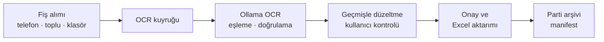
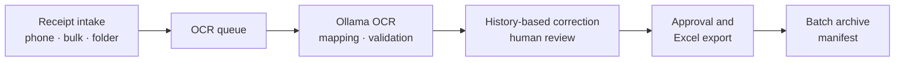

<a id="readme"></a>

<div align="center">

# Mazot Fiş Takip Sistemi

### Fuel Receipt Tracking System

Yerel OCR · Kullanıcı kontrollü doğrulama · Excel aktarımı  
Local OCR · Human review · Excel export

[**Türkçe**](#turkce) · [**English**](#english)

[](https://github.com/MehmetEmreee/mazot-fis-takip-sistemi/blob/main/LICENSE)
[](#tr-requirements)
[](#tr-architecture)

</div>

---

<a id="turkce"></a>

## Türkçe

[English version ↓](#english)

**Yerel yapay zekâ ile fiş okuma, kullanıcı kontrollü doğrulama ve Excel aktarımı.**

Akaryakıt fişi fotoğraflarını yapılandırılmış kayıtlara dönüştüren, tarayıcı üzerinden kullanılan yerel bir uygulama. Fişler Ollama üzerinde çalışan görsel dil modeliyle okunur; kullanıcı sonuçları görselle karşılaştırır, düzeltir ve onayladığı kayıtları mevcut Excel defterine aktarır.

> OCR çıktısı bir öneridir. Muhasebe veya operasyon kayıtlarına aktarılmadan önce fişin aslıyla karşılaştırılmalıdır. Bu proje, mevcut haliyle kurumsal üretim sertifikasyonu veya hatasız çalışma garantisi sunmaz.

## İçindekiler

- [Yetenekler](#tr-features)
- [Çalışma akışı](#tr-workflow)
- [Gereksinimler](#tr-requirements)
- [Kurulum ve başlatma](#tr-installation)
- [Kullanım](#tr-usage)
- [Excel sözleşmesi](#tr-excel)
- [Veri, yedekleme ve güvenlik](#tr-data-security)
- [Mimari](#tr-architecture)
- [Yapılandırma](#tr-configuration)
- [Test ve ölçüm](#tr-testing)
- [Bilinen sınırlamalar](#tr-limitations)
- [Sorun giderme](#tr-troubleshooting)
- [Katkı ve lisans](#tr-contributing)

<a id="tr-features"></a>

## Yetenekler

| Alan | Kapsam |
| --- | --- |
| Görsel alımı | Bilgisayardan toplu seçim, telefon tarayıcısı ve izlenen gelen kutusu klasörü |
| Görsel biçimleri | JPEG, PNG, WEBP, BMP; `pillow-heif` ile HEIC/HEIF dönüşümü |
| Yerel OCR | Ollama üzerinden varsayılan `qwen2.5vl:7b` modeli |
| Yapılandırılmış alanlar | Fiş numarası, tarih, firma, plaka/ekipman, ad soyad, kilometre ve litre |
| Kontrol ekranı | Görsel ve alanları birlikte inceleme, yakınlaştırma, döndürme ve elle düzeltme |
| Geçmişten öğrenme | Excel referansları ve kullanıcı düzeltmelerinden öneriler; belirli eşiklerde otomatik düzeltme |
| Parti yönetimi | Aktif kayıtları gruplama, arşivleme ve eski partileri inceleme |
| Excel aktarımı | Kullanıcının seçtiği dosya, sayfa ve başlangıç satırına manuel aktarım |
| Veri koruma | Görsel hash kontrolü, mantıksal silme, günlük JSON/Excel yedekleri ve arşiv manifestleri |

**Dil kapsamı:** README Türkçe ve İngilizce sunulur. Uygulama arayüzü ve iş kuralları Türkçe odaklıdır; uygulama içinde dil değiştirme özelliği bulunmaz.

<a id="tr-workflow"></a>

## Çalışma akışı



Model ilk kurulumda indirilir. Bağımlılıklar ve model hazır olduğunda normal OCR akışı yerelde çalışır; uygulamanın fiş okuma akışı bir bulut OCR hizmeti kullanmaz.

<a id="tr-requirements"></a>

## Gereksinimler

- Windows veya macOS: depoda bu sistemlere yönelik kurulum ve başlatma betikleri bulunur.
- Kaynaktan çalıştırmak için **Python 3.10+**. Python 3.12, macOS kurulum yardımcısının ilk tercihidir.
- [Ollama](https://ollama.com/download) ve `qwen2.5vl:7b` modeli.
- Güncel bir web tarayıcısı.
- Model, görseller, Excel dosyaları ve yedekler için yeterli disk alanı.
- İlk kurulum ve model indirme sırasında internet bağlantısı.

GPU hızlandırması OCR süresini iyileştirebilir. Doğrulanmış minimum RAM/VRAM sınırı veya donanımlar arası performans garantisi yayımlanmamıştır. Hedef bilgisayarda ölçüm yapın. Linux için özel başlatma betiği ve doğrulanmış platform testi bulunmaz.

<a id="tr-installation"></a>

## Kurulum ve başlatma

### 1. Depoyu alın

```bash
git clone https://github.com/MehmetEmreee/mazot-fis-takip-sistemi.git
cd mazot-fis-takip-sistemi
```

### 2. İşletim sisteminize göre kurun

| Sistem | İlk kurulum | Sonraki açılışlar |
| --- | --- | --- |
| Windows | Ollama'yı kurun, ardından `KURULUM.bat` çalıştırın. | `BASLAT_ARAYUZ.bat` |
| macOS | Ollama'yı kurun, ardından `KURULUM.command` çalıştırın. | `BASLAT.command` |

Kurulum betikleri varsayılan modeli indirir ve Python ortamını hazırlar. macOS'ta dosyalar çift tıklamayla çalışmıyorsa terminalden `bash KURULUM.command` ve `bash BASLAT.command` kullanılabilir.

### 3. Kaynaktan manuel kurulum

Önce Ollama hizmetini açın ve modeli indirin:

```bash
ollama pull qwen2.5vl:7b
```

**Windows — PowerShell:**

```powershell
py -3.12 -m venv .venv
.\.venv\Scripts\python.exe -m pip install -r requirements.txt
.\.venv\Scripts\python.exe uygulama.py
```

**macOS:**

```bash
python3 -m venv .venv
.venv/bin/python -m pip install -r requirements.txt
.venv/bin/python uygulama.py
```

Tarayıcı `http://127.0.0.1:8765` adresinde açılır. Başlatıcı terminalinin kapanması uygulamayı durdurur.

> Varsayılan başlatıcı sunucuyu `0.0.0.0:8765` üzerinde açar; aynı ağa erişimi olan istemciler uygulamaya ulaşabilir. Yalnız bilgisayarda kullanım için aşağıdaki yerel başlatma seçeneğini kullanın.

### Yalnız bu bilgisayardan erişim

Ollama hizmetini ayrıca açtıktan sonra:

```bash
# macOS; Windows'ta Python yolu: .\.venv\Scripts\python.exe
.venv/bin/python arayuz.py --host 127.0.0.1 --port 8765
```

Bu komut başlatıcının günlük yedekleme ve Ollama hazırlama adımlarını çalıştırmaz. Yedeklerinizi ayrıca yönetin.

### Windows EXE

Başlatma betiği `.venv\Scripts\python.exe` varsa kaynak kodu, yoksa mevcut EXE'yi kullanır. Depodaki EXE'nin güncel kaynakla aynı sürüm olduğunu varsaymayın. Yeniden paketlemek için Windows'ta `EXE_OLUSTUR.bat` çalıştırın; işlem PyInstaller kullanır ve mevcut dağıtım dosyasını günceller.

<a id="tr-usage"></a>

## Kullanım

1. **Fişleri ekleyin:** Toplu Ekle ekranını, telefon sayfasını veya `gelen_fisler/` klasörünü kullanın.
2. **OCR'ın tamamlanmasını bekleyin:** İşleme sürerken fişi silmeyin, düzeltmeyin veya onaylamayın.
3. **Asıl görselle karşılaştırın:** Özellikle fiş numarası, tarih, plaka, kilometre ve litreyi kontrol edin. Geçmiş önerileri doğruluk garantisi değildir.
4. **Düzeltin ve onaylayın:** `Doğru, onayla` düğmesini kullanın. Hızlı onay ve sonraki kayıt için `Ctrl + Enter` kullanılabilir.
5. **Excel'e aktarın:** Dosya, sayfa ve başlangıç satırını seçin. Hedef Excel'i kapatın ve hedef hücrelerin boş olduğunu doğrulayın.
6. **Yeni parti açın:** OCR işlemleri ve onaylar tamamlandıktan sonra `+ Yeni` ile mevcut partiyi arşivleyin.

### Telefon ve gelen kutusu

Telefon ve bilgisayar aynı güvenilir yerel ağdayken terminalde gösterilen `http://<bilgisayar-ip>:8765/cek` adresini açın. Gerekirse işletim sistemi güvenlik duvarında yalnız güvenilir yerel ağ erişimini sağlayın.

Çok sayıda görsel için LocalSend, USB veya bir klasör senkronizasyon aracıyla dosyaları `gelen_fisler/` içine bırakabilirsiniz. İzleyici yaklaşık üç saniyede bir tarar; dosyayı iki ardışık taramada değişmeden gördüğünde ve bütünlük kontrolü geçtiğinde kabul eder.

| Gelen kutusu alt klasörü | Anlamı |
| --- | --- |
| `_islendi/<tarih>/` | Kuyruğa kabul edilmiş kaynak görseller; OCR başarısı anlamına gelmez. |
| `_tekrar/` | Mevcut hash indeksine göre daha önce kabul edilmiş görseller |
| `_hatali/` | Desteklenmeyen, bozuk veya bekleme süresini aşan eksik dosyalar |

<a id="tr-excel"></a>

## Excel sözleşmesi

Uygulama genel amaçlı bir Excel şema eşleyicisi değildir. Aktarım sütunları mevcut iş akışına göre sabittir:

| Sütun | Alan |
| --- | --- |
| A | Tarih |
| B | Fiş / fatura numarası |
| C | Firma |
| D | Araç plakası / ekipman |
| E | Ad soyad |
| F | Kilometre |
| H | Alınan litre |

G ve I–M sütunlarına aktarım yapılmaz. Varsayılan başlangıç, son işlem satırından iki satır sonradır; arada bir boş satır bırakılır. Hücre biçimleri son işlem satırından kopyalanır. Normal aktarım yalnız onaylı, silinmemiş, OCR hatası taşımayan ve daha önce aktarılmamış kayıtları seçer. `Tümü` seçeneği daha önce aktarılmış kayıtları da kapsar; aynı hedefte mükerrer satırlar oluşturabilir.

`.xlsx` ve `.xlsm` dosyaları seçilebilir. Makro içeren defterlerde makroların korunması güvence altına alınmış değildir; doğrulama yapılmadan asıl `.xlsm` dosyasına aktarım yapmayın.

<a id="tr-data-security"></a>

## Veri, yedekleme ve güvenlik

| Konum | İçerik |
| --- | --- |
| `sonuclar.json` | Aktif fiş kayıtları ve işlem durumu |
| `fisler/` | Geçici, firma bazında düzenlenmiş ve silinen görseller |
| `gelen_fisler/` | İzlenen giriş klasörü ve kaynak görseller |
| `excel_referans.json` | Excel'den öğrenilen referanslar |
| `kullanici_ogrenmeleri.json` | Kullanıcı düzeltmeleri ve eşleştirmeler |
| `aktif_parti.json` | Aktif parti bilgisi |
| `arsiv/` | Kapanan partiler, görseller ve bütünlük manifestleri |
| `output/` | Yüklenen Excel dosyaları ve son aktarım ayarları |
| `yedekler/` | Otomatik JSON ve Excel yedekleri |

`uygulama.py`, açılışta belirli JSON/ayar dosyalarını günde bir kez yedekler. Excel aktarımı hedef dosya için günde bir kez yazma öncesi kopya oluşturur. Bu yedekler her işlemin sürümünü veya bütün görselleri kapsamaz. Tam yedek için uygulamayı durdurun; yukarıdaki veri konumlarıyla birlikte proje dışında kullanılan hedef Excel dosyalarını da ayrı bir depolamaya kopyalayın. Düzenli geri yükleme denemesi yapın.

Fişler isim, plaka ve firma bilgisi içerebilir. `.gitignore` birçok çalışma verisini dışlar; bu, şifreleme veya erişim kontrolü sağlamaz. Uygulamada kullanıcı hesabı, rol tabanlı yetkilendirme ve yerleşik HTTPS bulunmaz. İnternete açmayın, port yönlendirme yapmayın; erişimi güvenilir cihazlarla sınırlayın. Uygulama Türkçe fiş şablonuna ve belirli iş kurallarına göre tasarlanmıştır.

<a id="tr-architecture"></a>

## Mimari

| Bileşen | Sorumluluk |
| --- | --- |
| `uygulama.py` | Başlatma, yollar, günlük veri yedeği ve Ollama kontrolü |
| `arayuz.py` | HTTP API, yüklemeler, klasör izleme, kayıt yönetimi ve OCR işçisi |
| `extract_json.py` | Görsel hazırlama, Ollama çağrısı ve ham alan eşleme |
| `normalizasyon.py` / `dogrulama.py` | Alan normalizasyonu ve merkezi iş kuralları |
| `excel_ogrenme.py` | Referanslar, benzerlik önerileri ve öğrenilen düzeltmeler |
| `excel_aktar.py` | Excel önizleme, yedekleme ve aktarım |
| `parti_yonetimi.py` | Parti arşivleme ve SHA-256 manifestleri |
| `ui/` | HTML, CSS ve JavaScript kontrol arayüzü |

Çalışma zamanı: Python standart HTTP sunucusu, Pillow, Requests, RapidFuzz, openpyxl, pillow-heif, NumPy ve OpenCV (şüpheli alanların yeniden okunmasında tablo kutularını bulmak için). Kalıcılık JSON ve dosya sistemi üzerinden sağlanır; ayrı veritabanı yoktur. OCR işleri tek arka plan işçisiyle sırayla çalışır.

<a id="tr-configuration"></a>

## Yapılandırma

| Ayar | Varsayılan | Açıklama |
| --- | --- | --- |
| `QWEN_MODEL` | `qwen2.5vl:7b` | Süreç başlatılırken seçilen Ollama modeli |
| `QWEN_NUM_CTX` | `4096` | Model bağlam boyutu |
| `MAZOT_YENIDEN_OKUMA` | `1` | `0` ise, otomatik düzeltmeden sonra geçmişte karşılığı olmayan alanların kırpılıp yeniden okunması kapanır |
| OCR uzun kenarı | `1600` px | Kaynak koddaki varsayılan görsel küçültme sınırı |
| Ollama OCR adresi | `http://localhost:11434/api/chat` | Kaynak kodda tanımlı; ortam değişkeni değildir. |
| Yükleme sınırı | `30 MiB` | Tek yükleme için sunucu sınırı |

Doğrudan sunucu seçenekleri:

```text
arayuz.py --host ADRES --port PORT --data-file JSON_YOLU
          --fisler-dir GORSEL_DIZINI --gelen-dir GELEN_DIZINI --no-browser
```

Bu seçenekler bütün uygulama verilerini tek başına izole etmez; öğrenme ve bazı çıktı yolları proje köküne bağlı kalır. Tam izolasyon gereken deneylerde ayrı bir proje kopyası kullanın. Alternatif model önce Ollama'ya kurulmalıdır; kurulum betikleri `QWEN_MODEL` değerinden bağımsız olarak varsayılan modeli indirir.

<a id="tr-testing"></a>

## Test ve ölçüm

Temel testleri kurulu sanal ortamın Python'u ile çalıştırın:

```bash
python -m unittest -v test_is_kurallari test_toplu_yukleme
```

Normalizasyon, doğrulama, öğrenme, temel arşivleme ve toplu yükleme kontrolleri Ollama olmadan çalışabilir. Bazı Excel testleri kişisel örnek dosya yoksa atlanır. `test_qwen_vl.py` ve `test_trocr.py`, temel otomatik paketten ayrı OCR deney araçlarıdır; TrOCR ek bağımlılıklar ve model indirmesi gerektirir.

Etiketlenmiş fiş kopyalarıyla OCR karşılaştırması:

```bash
python ocr_benchmark.py --model qwen2.5vl:7b --max-kenar 1600 \
  --ornek 20 --data-file /path/to/sonuclar.json \
  --images-dir /path/to/fisler --output /path/to/benchmark_sonucu.json
```

Windows'ta komutu tek satırda ve uygun dosya yollarıyla kullanın. Araç onaylı ve ham OCR alanları bulunan kayıtları örnekler; üretimdeki otomatik öğrenme düzeltmesini bütünüyle ölçmez. Model, donanım, görsel kümesi ve soğuk/sıcak çalışma koşullarını sonuçlarla birlikte kaydedin. Eksik görseller nedeniyle ölçülen örnek sayısı istenenden az olabilir. Sonuç dosyaları kişisel veri içerebilir.

<a id="tr-limitations"></a>

## Bilinen sınırlamalar

Aşağıdaki durumlar kaynak incelemesinde belirlenmiştir; uygulamayı kritik kayıtların tek doğruluk kaynağı olarak kullanmadan önce değerlendirin:

- Noktalı ondalık litre değeri, örneğin `12.5`, Excel dönüşümünde `125` olabilir. Aktarım öncesi kopyada sonucu kontrol edin.
- Excel kaydedildikten sonra JSON yazımı başarısız olursa yeniden deneme mükerrer kayıt oluşturabilir. Hata sonrası hedef defteri incelemeden tekrar aktarmayın.
- OCR sürerken yapılan kullanıcı işlemleri sonuç geldiğinde ezilebilir; işleme tamamlanana kadar kaydı değiştirmeyin.
- OCR sonrası öğrenme veya kayıt hataları tek işçiyi durdurabilir; kuyruk ilerlemesini takip edin.
- Eşzamanlı aktif/arşiv Excel istekleri ortak veri yolu durumunu değiştirebilir; çoklu sekmeden eşzamanlı aktarım/önizleme kullanmayın.
- Başlangıç satırı seçimi dolu hücreleri ezebilir; hedef aralığı önceden doğrulayın.
- Bağımlılıklar tam sürümlerle kilitlenmemiştir. Kurulumlar arası davranış için aynı sürümleri ayrıca kaydedin.

<a id="tr-troubleshooting"></a>

## Sorun giderme

| Belirti | Kontrol |
| --- | --- |
| Ollama/model bulunamadı | Ollama'yı açın; `ollama list` ile modeli kontrol edin; gerekirse `ollama pull qwen2.5vl:7b` çalıştırın. |
| Telefon bağlanamıyor | Aynı ağ, terminaldeki bilgisayar IP'si, güvenlik duvarı ve sunucunun bağlanma adresini kontrol edin. `127.0.0.1` telefondan erişilemez. |
| HEIC açılamıyor | Sanal ortamda `pillow-heif` kurulumunu kontrol edin veya JPEG kullanın. |
| Excel yazılamıyor | Dosyayı Excel'de kapatın; izinleri, disk alanını ve yedek klasörünü kontrol edin. |
| Kuyruk ilerlemiyor | Terminal hatalarını ve Ollama durumunu inceleyin. Yeniden başlatmadan önce verilerin yedeğini alın. |
| Kaynak değişti, EXE değişmedi | `.venv` ile kaynaktan çalıştırın veya Windows EXE'sini yeniden oluşturun. |

<a id="tr-contributing"></a>

## Katkı ve lisans

Hata bildiriminde işletim sistemi, Python/Ollama sürümleri, model adı, commit, yeniden üretme adımları ve kişisel verilerden arındırılmış hata çıktısını paylaşın. Gerçek fiş veya muhasebe defteri yüklemeyin. Düzeltmeler için regresyon testi; performans değişiklikleri için aynı koşullarda önce/sonra ölçümü ekleyin.

[Hata bildirimi](https://github.com/MehmetEmreee/mazot-fis-takip-sistemi/issues) · [Kısa kullanım kılavuzu](https://github.com/MehmetEmreee/mazot-fis-takip-sistemi/blob/main/KULLANIM.md)

[MIT Lisansı](https://github.com/MehmetEmreee/mazot-fis-takip-sistemi/blob/main/LICENSE) · © 2026 Mehmet Emre Çelebi. Üçüncü taraf yazılım ve model lisansları ayrıca geçerlidir.

[↑ Dil seçimi / Language selection](#readme)

---

<a id="english"></a>

## English

[Türkçe sürüm ↑](#turkce)

**Local AI receipt extraction, human review, and Excel export.**

A locally hosted, browser-based application that converts fuel receipt photographs into structured records. A vision-language model running through Ollama reads each receipt; users compare the results against the image, correct the fields, and export approved records to an existing Excel workbook.

> OCR output is a suggestion. Verify it against the original receipt before using it for accounting or operational records. The current project does not provide enterprise production certification or a guarantee of error-free operation.

## Contents

- [Capabilities](#en-features)
- [Workflow](#en-workflow)
- [Requirements](#en-requirements)
- [Installation and startup](#en-installation)
- [Usage](#en-usage)
- [Excel contract](#en-excel)
- [Data, backups, and security](#en-data-security)
- [Architecture](#en-architecture)
- [Configuration](#en-configuration)
- [Testing and measurement](#en-testing)
- [Known limitations](#en-limitations)
- [Troubleshooting](#en-troubleshooting)
- [Contributing and license](#en-contributing)

<a id="en-features"></a>

## Capabilities

| Area | Scope |
| --- | --- |
| Image intake | Desktop bulk selection, a phone browser, and a watched inbox directory |
| Image formats | JPEG, PNG, WEBP, BMP; HEIC/HEIF conversion through `pillow-heif` |
| Local OCR | Ollama with `qwen2.5vl:7b` as the default model |
| Structured fields | Receipt number, date, company, vehicle plate/equipment, person, mileage, and fuel volume |
| Review interface | Image and field comparison, zoom, rotation, and manual corrections |
| Learning from history | Suggestions from Excel references and user corrections; automatic corrections at defined thresholds |
| Batch management | Group active records, archive completed batches, and inspect past batches |
| Excel export | Manual export to a user-selected workbook, sheet, and starting row |
| Data safeguards | Image hash checks, soft deletion, daily JSON/Excel backups, and archive manifests |

**Language scope:** This README is available in Turkish and English. The application interface and business rules are Turkish-oriented; the application does not currently include a language switcher.

<a id="en-workflow"></a>

## Workflow



The model is downloaded during initial setup. Once dependencies and the model are available, the normal OCR workflow runs locally; the application's receipt extraction workflow does not use a cloud OCR service.

<a id="en-requirements"></a>

## Requirements

- Windows or macOS: the repository includes setup and startup scripts for these platforms.
- **Python 3.10+** for running from source. Python 3.12 is the first choice in the macOS environment helper.
- [Ollama](https://ollama.com/download) and the `qwen2.5vl:7b` model.
- A current web browser.
- Sufficient disk space for the model, images, Excel files, and backups.
- An internet connection for initial dependency installation and model downloads.

GPU acceleration may improve OCR latency. No validated minimum RAM/VRAM requirement or cross-hardware performance guarantee has been published. Benchmark on the target computer. Linux has no dedicated startup script or verified platform test.

<a id="en-installation"></a>

## Installation and startup

### 1. Get the repository

```bash
git clone https://github.com/MehmetEmreee/mazot-fis-takip-sistemi.git
cd mazot-fis-takip-sistemi
```

### 2. Use the platform setup scripts

| Platform | Initial setup | Subsequent launches |
| --- | --- | --- |
| Windows | Install Ollama, then run `KURULUM.bat`. | `BASLAT_ARAYUZ.bat` |
| macOS | Install Ollama, then run `KURULUM.command`. | `BASLAT.command` |

The setup scripts download the default model and prepare the Python environment. If double-clicking the macOS scripts does not work, run `bash KURULUM.command` and `bash BASLAT.command` from a terminal.

### 3. Manual setup from source

Start the Ollama service and download the model:

```bash
ollama pull qwen2.5vl:7b
```

**Windows — PowerShell:**

```powershell
py -3.12 -m venv .venv
.\.venv\Scripts\python.exe -m pip install -r requirements.txt
.\.venv\Scripts\python.exe uygulama.py
```

**macOS:**

```bash
python3 -m venv .venv
.venv/bin/python -m pip install -r requirements.txt
.venv/bin/python uygulama.py
```

The browser opens at `http://127.0.0.1:8765`. Closing the launcher terminal stops the application.

> The default launcher binds the server to `0.0.0.0:8765`, making it reachable by clients with network access to the computer. For computer-only access, use the loopback startup option below.

### Computer-only access

Start Ollama separately, then run:

```bash
# macOS; on Windows, use .\.venv\Scripts\python.exe instead
.venv/bin/python arayuz.py --host 127.0.0.1 --port 8765
```

This command bypasses the launcher's daily backup and Ollama preparation steps. Manage backups separately.

### Windows executable

The startup script runs source code when `.venv\Scripts\python.exe` exists; otherwise, it uses the available EXE. Do not assume the committed EXE matches the latest source. To rebuild on Windows, run `EXE_OLUSTUR.bat`; this uses PyInstaller and replaces the existing distribution executable.

<a id="en-usage"></a>

## Usage

1. **Add receipts:** Use `Toplu Ekle` (Bulk Add), the phone page, or the `gelen_fisler/` directory.
2. **Wait for OCR to finish:** Do not delete, edit, or approve a receipt while it is processing.
3. **Compare with the original image:** Pay particular attention to the receipt number, date, plate, mileage, and fuel volume. Historical suggestions are not a correctness guarantee.
4. **Correct and approve:** Select `Doğru, onayla` (Approve). `Ctrl + Enter` approves the current receipt and advances to the next one.
5. **Export to Excel:** Select the workbook, sheet, and starting row. Close the target workbook in Excel and verify that the destination cells are empty.
6. **Start a new batch:** After OCR and approvals are complete, use `+ Yeni` (New) to archive the current batch.

### Phone access and watched inbox

With the phone and computer on the same trusted local network, open the terminal-displayed address `http://<computer-ip>:8765/cek`. If necessary, allow access through the operating system firewall only for a trusted local network.

For larger collections, use LocalSend, USB, or a folder synchronization tool to place images in `gelen_fisler/`. The watcher scans approximately every three seconds and accepts a file after it remains unchanged across two consecutive scans and passes the completeness check.

| Inbox subdirectory | Meaning |
| --- | --- |
| `_islendi/<date>/` | Source images accepted into the queue; this does not indicate successful OCR. |
| `_tekrar/` | Images already accepted according to the current hash index |
| `_hatali/` | Unsupported, corrupt, or incomplete files that exceeded the waiting period |

<a id="en-excel"></a>

## Excel contract

The application is not a general-purpose Excel schema mapper. Export columns are fixed to the existing workflow:

| Column | Field |
| --- | --- |
| A | Date |
| B | Receipt / invoice number |
| C | Company |
| D | Vehicle plate / equipment |
| E | Person's name |
| F | Mileage |
| H | Fuel volume in litres |

The exporter does not write columns G or I–M. The default starting row is two rows after the last transaction row, leaving one blank row. Cell formatting is copied from the last transaction row. Normal export selects approved, non-deleted records without an OCR error that have not already been exported. The `Tümü` (All) option also includes previously exported records and can create duplicates in the same destination.

`.xlsx` and `.xlsm` files can be selected. Macro preservation is not assured; do not export to an original macro-enabled workbook without validating preservation on a copy first.

<a id="en-data-security"></a>

## Data, backups, and security

| Location | Contents |
| --- | --- |
| `sonuclar.json` | Active receipt records and processing state |
| `fisler/` | Temporary images, company-organized images, and soft-deleted images |
| `gelen_fisler/` | Watched inbox and original source images |
| `excel_referans.json` | References learned from Excel |
| `kullanici_ogrenmeleri.json` | User corrections and learned mappings |
| `aktif_parti.json` | Active batch metadata |
| `arsiv/` | Closed batches, images, and integrity manifests |
| `output/` | Uploaded workbooks and last export settings |
| `yedekler/` | Automatic JSON and Excel backups |

At startup, `uygulama.py` backs up selected JSON/settings files once per day. Excel export creates a pre-write copy of each target workbook once per day. These backups do not capture every transaction version or all images. For a complete backup, stop the application and copy the data locations above, together with any external destination workbooks, to separate storage. Test restoration regularly.

Receipts may contain names, vehicle plates, and company information. `.gitignore` excludes many runtime files; it does not provide encryption or access control. The application has no user accounts, role-based authorization, or built-in HTTPS. Do not expose it to the internet or configure port forwarding; limit access to trusted devices. The application is designed around Turkish receipt layouts and specific business rules.

<a id="en-architecture"></a>

## Architecture

| Component | Responsibility |
| --- | --- |
| `uygulama.py` | Startup, paths, daily data backup, and Ollama checks |
| `arayuz.py` | HTTP API, uploads, inbox watcher, record management, and OCR worker |
| `extract_json.py` | Image preparation, Ollama requests, and raw field mapping |
| `normalizasyon.py` / `dogrulama.py` | Field normalization and centralized business rules |
| `excel_ogrenme.py` | References, similarity suggestions, and learned corrections |
| `excel_aktar.py` | Excel preview, backup, and export |
| `parti_yonetimi.py` | Batch archival and SHA-256 manifests |
| `ui/` | HTML, CSS, and JavaScript review interface |

Runtime technologies include Python's standard HTTP server, Pillow, Requests, RapidFuzz, openpyxl, pillow-heif, NumPy, and OpenCV (used to locate table cells when re-reading suspicious fields). Persistence uses JSON and the file system; there is no separate database. A single background worker processes OCR jobs sequentially.

<a id="en-configuration"></a>

## Configuration

| Setting | Default | Description |
| --- | --- | --- |
| `QWEN_MODEL` | `qwen2.5vl:7b` | Ollama model selected when the process starts |
| `QWEN_NUM_CTX` | `4096` | Model context size |
| `MAZOT_YENIDEN_OKUMA` | `1` | Set to `0` to disable cropping and re-reading fields that have no match in history after automatic correction |
| OCR longest edge | `1600` px | Default image resizing limit defined in source |
| Ollama OCR endpoint | `http://localhost:11434/api/chat` | Defined in source; not an environment variable |
| Upload limit | `30 MiB` | Server limit per upload |

Direct server options:

```text
arayuz.py --host ADDRESS --port PORT --data-file JSON_PATH
          --fisler-dir IMAGE_DIR --gelen-dir INBOX_DIR --no-browser
```

These options do not isolate all application data: learning files and some output paths remain tied to the project root. Use a separate project copy for experiments requiring complete isolation. Install an alternative model in Ollama before selecting it. Setup scripts download the default model regardless of `QWEN_MODEL`.

<a id="en-testing"></a>

## Testing and measurement

Run the core suite using the installed virtual environment's Python:

```bash
python -m unittest -v test_is_kurallari test_toplu_yukleme
```

Normalization, validation, learning, basic archival, and bulk intake checks can run without Ollama. Some Excel tests are skipped when a personal sample workbook is unavailable. `test_qwen_vl.py` and `test_trocr.py` are separate OCR experiment tools, not part of the core automated suite. TrOCR requires additional dependencies and model downloads.

Compare OCR using copies of labelled receipts:

```bash
python ocr_benchmark.py --model qwen2.5vl:7b --max-kenar 1600 \
  --ornek 20 --data-file /path/to/sonuclar.json \
  --images-dir /path/to/fisler --output /path/to/benchmark_sonucu.json
```

On Windows, use a single command line and appropriate paths. The tool samples approved records with raw OCR fields; it does not fully measure the production learning-based correction stage. Record the model, hardware, image set, and cold/warm conditions alongside results. Missing images can reduce the measured sample count. Benchmark output may contain personal data.

<a id="en-limitations"></a>

## Known limitations

The following conditions were identified during source review. Evaluate them before treating the application as the sole source of truth for critical records:

- A dot-decimal fuel value such as `12.5` can become `125` during Excel conversion. Inspect the exported result on a copy.
- If JSON writing fails after the workbook has been saved, retrying can create duplicate rows. Inspect the destination before retrying a failed export.
- User actions during OCR can be overwritten when the result arrives. Wait for processing to finish before changing a record.
- Post-OCR learning or persistence errors can stop the single worker. Monitor queue progress.
- Concurrent active/archive Excel requests can change shared data-path state. Avoid simultaneous export/preview operations from multiple tabs.
- Selecting a starting row can overwrite populated cells. Check the destination range first.
- Dependencies are not locked to exact versions. Record installed versions when reproducing behavior across installations.

<a id="en-troubleshooting"></a>

## Troubleshooting

| Symptom | Check |
| --- | --- |
| Ollama or model unavailable | Start Ollama; check `ollama list`; run `ollama pull qwen2.5vl:7b` if needed. |
| Phone cannot connect | Check the network, computer IP displayed in the terminal, firewall, and bind address. `127.0.0.1` is not accessible from the phone. |
| HEIC cannot be opened | Check `pillow-heif` in the virtual environment or use JPEG. |
| Excel cannot be written | Close the workbook in Excel; check permissions, disk space, and the backup directory. |
| Queue stops progressing | Inspect terminal errors and Ollama status. Back up data before restarting. |
| Source changed but EXE did not | Run from source with `.venv` or rebuild the Windows executable. |

<a id="en-contributing"></a>

## Contributing and license

When reporting a bug, include the operating system, Python/Ollama versions, model name, commit, reproduction steps, and sanitized error output. Do not upload real receipts or accounting workbooks. Include regression tests for fixes and comparable before/after measurements for performance changes.

[Report an issue](https://github.com/MehmetEmreee/mazot-fis-takip-sistemi/issues) · [Quick user guide — Turkish](https://github.com/MehmetEmreee/mazot-fis-takip-sistemi/blob/main/KULLANIM.md)

[MIT License](https://github.com/MehmetEmreee/mazot-fis-takip-sistemi/blob/main/LICENSE) · © 2026 Mehmet Emre Çelebi. Third-party software and model licenses apply separately.

[↑ Türkçe](#turkce) · [↑ Language selection](#readme)
